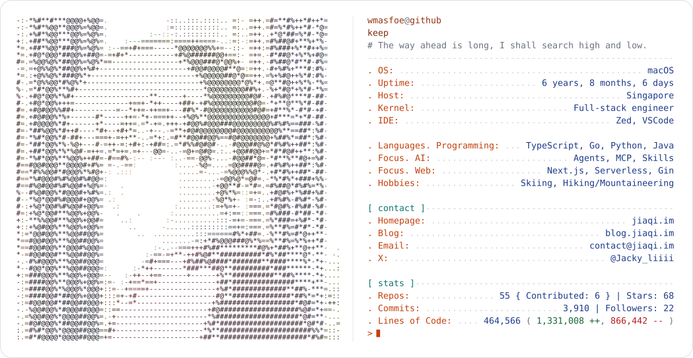
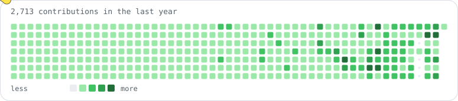

<!-- Generated from profile.config.json. Edit that file, then run `npm run generate`. -->

<a href="https://jiaqi.im">
  <picture>
    <source media="(prefers-color-scheme: dark)" srcset="assets/card-dark.svg">
    
  </picture>
</a>

<a href="https://jiaqi.im"><picture><source media="(prefers-color-scheme: dark)" srcset="assets/buttons/homepage-dark.svg"></picture></a><a href="https://blog.jiaqi.im"><picture><source media="(prefers-color-scheme: dark)" srcset="assets/buttons/blog-dark.svg"></picture></a><a href="mailto:contact@jiaqi.im"><picture><source media="(prefers-color-scheme: dark)" srcset="assets/buttons/email-dark.svg"></picture></a>

<picture>
  <source media="(prefers-color-scheme: dark)" srcset="assets/pacman-dark.svg">
  
</picture>
